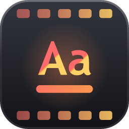
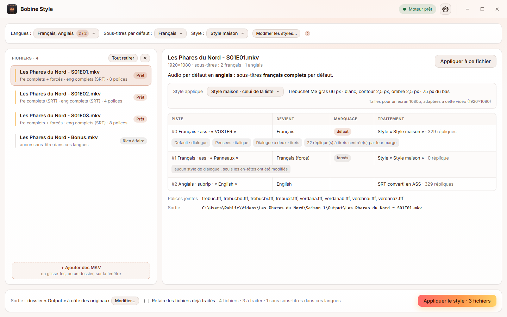
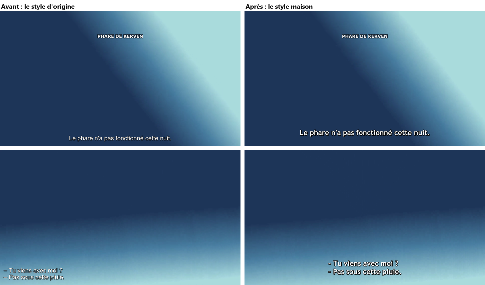

<a href="README.md">English</a> | Français

  

<h1 align="center">Bobine Style</h1>

  <b>Un style propre et lisible pour les sous-titres de tes MKV</b>, dans les langues de ton choix, à la bonne taille sur chaque vidéo.

  
  
  
  
  

  

<picture>
  <source media="(prefers-color-scheme: dark)" srcset="docs/screenshots/main-fr-dark.png">
  
</picture>

## Pourquoi

Les sous-titres arrivent dans tous les styles : un Arial fin d'un côté, une police énorme de l'autre, une piste difficile à lire sur une scène claire. Sur toute une vidéothèque, c'est un patchwork. Les restyler à la main, c'est ouvrir chaque fichier dans un éditeur de sous-titres, trouver quel style sert aux dialogues, lequel aux italiques, ne pas toucher aux panneaux, puis remuxer.

Bobine Style fait tout ça en une passe, pour un fichier ou une série entière, et nomme les pistes pour que Plex (ou n'importe quel lecteur) choisisse la bonne tout seul.

Il fait partie de **Bobine**, une petite suite d'outils pour vidéothèque, avec [Bobine Audio](https://github.com/MarcValat/BobineAudio) et [Bobine Subs](https://github.com/MarcValat/BobineSubs).

## Fonctionnalités

- 🎨 **Un style maison** : Trebuchet MS gras, blanc avec contour et ombre noirs, et ses variantes : italique, haut de l'écran, répliques à tirets (centrées, tirets alignés), paroles simultanées en jaune.
- ✏️ **Ou tes propres styles** : police, taille, couleurs, contour, ombre, marges, et chaque variante active ou non, avec un exemple à l'échelle de l'écran. Un style pour la liste, un autre pour un fichier ; importe-les et exporte-les.
- 🌍 **Toutes les langues de sous-titres** : le français par défaut, ou l'anglais, l'allemand, le japonais… plusieurs à la fois. Les autres sont copiées telles quelles.
- 📐 **La bonne taille sur chaque vidéo** : le style est défini pour un écran 1080p et adapté à chaque vidéo : même taille en 720p qu'en 4K, et un film scope (2,39:1) ou 4:3 garde la même taille à l'écran qu'un 16:9.
- 🔍 **Des rôles trouvés à l'usage, pas au nom** : quel style sert aux dialogues, aux italiques, au haut de l'écran… est déduit de la façon dont chaque style est utilisé, quel que soit son nom. Les panneaux et la typo restent exactement comme ils étaient.
- 🏷️ **Pistes complètes et forcées nommées et marquées**, dans leur propre langue : *Français* et *Français (forcé)*, *English* et *English (forced)*… Les sous-titres par défaut suivent l'audio par défaut : forcés quand l'audio est dans leur langue, complets sinon.
- 🔤 **Polices jointes** : la police du style et celles des panneaux sont jointes au MKV, pour que les sous-titres s'affichent pareil sur tous les lecteurs.
- 📝 **Les SRT aussi** : les pistes SRT sont converties en ASS dans le même style (italiques, `{\an8}`, répliques à tirets…).
- 🗂️ **Une série entière en une passe** : glisse un dossier, ses saisons sont incluses ; les fichiers déjà faits sont sautés.
- 🛡️ **Rien de perdu** : vidéo, audio, sous-titres des autres langues et chapitres sont copiés tels quels, rien n'est réencodé, le fichier d'origine n'est jamais modifié, et chaque sortie est vérifiée avant d'être gardée.
- 🖱️ **Glisser-déposer** de fichiers ou de dossiers entiers, en français ou en anglais, thème clair ou sombre (ou celui du système), mises à jour automatiques.

## Installation

**Windows 10 et 11 :**

1. Télécharge `Bobine.Style_x.y.z_x64-setup.exe` depuis la [dernière version](https://github.com/MarcValat/BobineStyle/releases/latest).
2. Lance-le. L'installateur n'est pas signé par un certificat, Windows SmartScreen peut donc afficher *« Windows a protégé votre ordinateur »* : clique sur **Informations complémentaires**, puis **Exécuter quand même**.

**Linux** (Ubuntu 22.04 ou plus récent, Debian et leurs dérivées) :

1. Télécharge `Bobine.Style_x.y.z_amd64.deb` depuis la [dernière version](https://github.com/MarcValat/BobineStyle/releases/latest).
2. Installe-le depuis son dossier avec `sudo apt install ./Bobine.Style_x.y.z_amd64.deb`, puis lance-le depuis le menu des applications.
3. Trebuchet MS n'est pas fournie avec Linux : installe-la (`sudo apt install ttf-mscorefonts-installer`) pour qu'elle puisse être jointe aux fichiers.

Le moteur et ffmpeg sont fournis avec l'application. Quand une nouvelle version sort, l'application la propose et l'installe en un clic.

## Comment ça marche

1. **Ajoute des MKV**, ou un dossier entier (une saison, une série), avec les boutons ou en les glissant sur la fenêtre.
2. **Choisis** en haut les langues de sous-titres, celle par défaut et le style.
3. **Vérifie** ce qui sera fait : clique sur un fichier pour voir le sort de chaque piste de sous-titres, la piste par défaut et les polices à joindre.
4. **Applique le style** : les nouveaux fichiers vont dans un dossier `Output` à côté des originaux (ou dans le dossier de ton choix), sous le même nom.

📖 Le [guide d'utilisation](docs/guide.fr.md) explique tout en détail : les langues et la piste par défaut, les styles, la détection des rôles, FAQ.

## Bon à savoir

- Seules les pistes des **langues choisies** sont restylées (une piste sans langue indiquée est prise d'après son titre, ou comme étant dans la langue par défaut quand le fichier n'en a aucune dans celle-ci). Les autres langues restent telles quelles.
- Les pistes faites uniquement de panneaux (une piste « Signs ») sont marquées forcées mais pas restylées : leur typo est gardée telle qu'elle a été conçue.
- Certaines applications TV (Plex sur certaines TV connectées, par exemple) transforment les sous-titres ASS en texte simple et ignorent tout style : un fichier n'y peut rien. Le style s'affiche sur les lecteurs qui rendent l'ASS (Plex sur ordinateur, Infuse, VLC, mpv, Kodi), et quand le serveur Plex incruste les sous-titres dans l'image.

## Pour les développeurs

- [`engine/`](engine/README.md) : le moteur Python (lecture des pistes, détection des rôles, style, conversion SRT, remux, serveur HTTP local) ; utilisable seul en ligne de commande.
- [`app/`](app/README.md) : l'application (Tauri + React/TypeScript), qui pilote le moteur ; build, empaquetage et publication d'une version.

## Licence

Copyright © 2026 Marc Valat. Bobine Style est un logiciel libre, publié sous la [licence publique générale GNU v3](LICENSE) : tu peux l'utiliser, l'étudier, le partager et le modifier, et toute version que tu distribues, modifiée ou non, doit rester sous la même licence avec son code source disponible.

L'installateur fournit aussi [FFmpeg](https://ffmpeg.org/) (une build [gyan.dev](https://www.gyan.dev/ffmpeg/builds/), via [imageio-ffmpeg](https://github.com/imageio/imageio-ffmpeg)), que Bobine Style lance comme programme séparé. Cette build est aussi sous GPL v3 ; son code source est disponible auprès de FFmpeg et de gyan.dev.

L'interface utilise la police [Inter](https://rsms.me/inter/) (intégrée via [Fontsource](https://fontsource.org/fonts/inter)), sous [licence SIL Open Font License 1.1](https://openfontlicense.org/).

Aucune police de sous-titres n'est fournie : Trebuchet MS et les autres sont prises sur ton ordinateur et jointes à tes propres fichiers.
