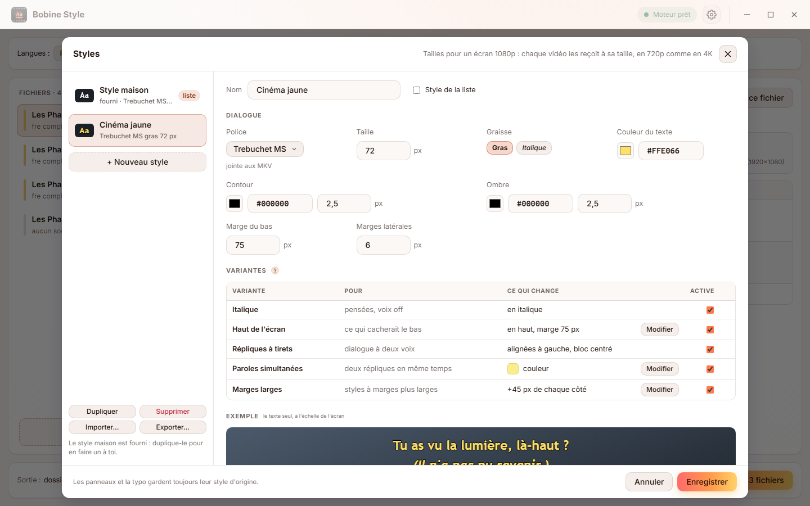

<a href="guide.md">English</a> | Français

# Guide d'utilisation

Ce guide explique comment utiliser Bobine Style et ce qu'il fait exactement à un fichier. Pour l'installer, voir le [README](../README.fr.md#installation). L'interface est en français ou en anglais (⚙ *Paramètres*, *Langue*).

## Sommaire

1. [Les mots à connaître](#les-mots-à-connaître)
2. [Traiter des fichiers](#traiter-des-fichiers)
3. [Les langues et la piste par défaut](#les-langues-et-la-piste-par-défaut)
4. [Lire le détail d'un fichier](#lire-le-détail-dun-fichier)
5. [Les styles](#les-styles)
6. [La bonne taille sur chaque vidéo](#la-bonne-taille-sur-chaque-vidéo)
7. [Comment les rôles sont trouvés](#comment-les-rôles-sont-trouvés)
8. [Les noms des pistes](#les-noms-des-pistes)
9. [Les polices](#les-polices)
10. [Les paramètres](#les-paramètres)
11. [FAQ](#faq)

## Les mots à connaître

- **Piste complète** (*complets*) : les sous-titres de tout le film, chaque réplique.
- **Piste forcée** (*forcés*) : seulement ce que l'audio ne dit pas dans cette langue : panneaux, passages en langue étrangère. Les lecteurs l'affichent d'eux-mêmes quand l'audio est dans cette langue.
- **Style** : dans un fichier de sous-titres ASS, un ensemble nommé de police, taille, couleurs, position. Chaque ligne en utilise un.
- **Rôle** : ce à quoi sert un style : dialogue, italique (pensées, voix off), haut de l'écran, répliques à tirets (deux personnages dans un même sous-titre), paroles simultanées, ou typo (panneaux, titres, karaoké).
- **Style maison** : le style fourni avec Bobine Style, décrit [plus bas](#le-style-maison). Tu peux en faire un à toi à partir de lui.

## Traiter des fichiers

1. **Ajoute des MKV** : sur la fenêtre vide, clique sur la zone de dépôt pour choisir des fichiers, ou *Ajouter un dossier…* ; une fois la liste remplie, *+ Ajouter des MKV* sous elle. Ou glisse des fichiers ou des dossiers n'importe où sur la fenêtre. Un dossier apporte ses MKV et, avec *Inclure les sous-dossiers (saisons)* coché, ceux de ses saisons. Les dossiers `Output` et les fichiers inachevés ne sont jamais repris.
2. **Choisis les langues** en haut : *Langues* (les sous-titres à restyler et renommer), *Sous-titres par défaut* et *Style* (voir [plus bas](#les-langues-et-la-piste-par-défaut)). Chaque fichier est relu quand ils changent.
3. **Vérifie** ce qui sera fait : clique sur un fichier pour voir son [détail](#lire-le-détail-dun-fichier) à droite.
4. **Applique** (*Appliquer le style*, en bas à droite, avec le nombre de fichiers à traiter) : deux fichiers à la fois, chacun avec sa progression. *Annuler l'export* arrête : le fichier en cours d'écriture est supprimé, les originaux ne sont de toute façon jamais touchés. *Appliquer à ce fichier*, dans le détail d'un fichier, le traite seul.

**Où vont les résultats** (*Sortie*, en bas à gauche, *Modifier…*) :

- *À côté* : un dossier `Output` à côté de chaque fichier, sous le même nom ;
- *Autre dossier* : un seul dossier pour tout ; deux épisodes de même nom venant de saisons différentes vont dans le sous-dossier de leur saison.

*Refaire les fichiers déjà traités* retraite les fichiers dont le résultat existe déjà ; sinon ils sont marqués *Déjà traité* et sautés : une série interrompue se relance simplement.

Chaque fichier de la liste montre ce qui lui sera fait (*fre complets + forcés · 8 polices*…) et son état : *Lecture…*, *Prêt*, *Déjà traité*, *Rien à faire* (pas de sous-titres dans les langues choisies), *Illisible*, *En attente*, *Terminé*, *Échec* (la raison dans son détail), *Annulé*. Le pointeur dessus, ↑ ↓ le déplacent dans la liste et ✕ l'en retire (*Tout retirer* vide la liste). « replie la liste pour laisser plus de place au détail. Les touches ↑ et ↓ passent d'un fichier à l'autre.

## Les langues et la piste par défaut

**Langues** : les langues de sous-titres à traiter, une ou plusieurs (le français par défaut). Une fois des fichiers lus, la liste propose les langues qu'ils contiennent. Une piste d'une langue choisie est restylée et renommée ; les pistes des autres langues sont copiées telles quelles. Une piste sans langue indiquée est prise d'après son titre (*VOSTFR*, *English*…) ou, quand un fichier n'en a aucune dans la langue par défaut, comme étant dans celle-ci.

**Sous-titres par défaut** : la langue dont une piste devient celle par défaut, selon l'audio par défaut (la piste audio marquée par défaut, ou la première) :

| Audio par défaut | Sous-titres par défaut |
|---|---|
| Dans cette langue | sa piste forcée (aucune s'il n'y en a pas) |
| Une autre langue, inconnue, ou pas d'audio | sa piste complète (la forcée s'il n'y a pas de complète) |

Une piste de sous-titres d'une autre langue qui était par défaut ne l'est plus, pour que les lecteurs choisissent celle-ci.

Dans une langue, la piste qui a le plus de dialogue est la **complète**. Une piste est **forcée** quand elle est marquée comme telle, quand son titre le dit (*forc…*, *Signs*, *Panneaux*), ou quand elle a moins de la moitié du dialogue de la complète.

## Lire le détail d'un fichier

Clique sur un fichier pour voir, à droite :

- sa taille et ses pistes de sous-titres, puis **l'audio par défaut** et la piste de sous-titres qui en découle ;
- **le style appliqué** (*Style appliqué*) : celui de la liste, ou un autre pour ce fichier seulement, choisi là ; avec sa taille, ses couleurs et ses marges, et la taille de vidéo à laquelle il est adapté ;
- **chaque piste de sous-titres** : ce qu'elle est (langue, format, titre), ce qu'elle devient (*Devient*), son marquage (*Marquage* : *défaut*, *forcés*) et son traitement (*Traitement*) :
  - *Style « … »* : une piste ASS restylée, avec son nombre de répliques ;
  - *SRT converti en ASS* : une piste SRT convertie, puis stylée ;
  - *Copiée telle quelle* : copiée sans changement (langue non choisie, sous-titres images).

  Sous une piste restylée, le rôle de chacun de ses styles (*Default : dialogue*, *Pensées : italique*…) et ce qu'il faut savoir ;
- **les polices** à joindre (*Polices jointes*) et celles déjà dans le fichier (*Déjà dans le MKV*) ;
- **le chemin de sortie** (*Sortie*), puis, une fois écrit, *Ouvrir le dossier*.

## Les styles

*Style* en haut choisit le style de la liste ; un fichier peut en prendre un autre dans son détail. *Modifier les styles…* ouvre les styles :

<picture>
  <source media="(prefers-color-scheme: dark)" srcset="screenshots/styles-fr-dark.png">
  
</picture>

- **Le style maison** est fourni et ne se modifie pas : *Duplique*-le, ou *+ Nouveau style*, pour en faire un à toi.
- **Le dialogue d'un style** : *Police* (n'importe quelle police de ton ordinateur : elle est jointe aux MKV), *Taille*, *Gras*, *Italique*, *Couleur du texte*, *Contour* et *Ombre* (couleur et épaisseur), *Marge du bas*, *Marges latérales*. L'exemple montre le texte à l'échelle de l'écran.
- **Ses variantes** : les styles de dialogue d'un fichier en prennent chacun une selon leur usage (voir [Comment les rôles sont trouvés](#comment-les-rôles-sont-trouvés)). Chacune se désactive : les styles qui l'auraient prise gardent alors l'aspect du dialogue. *Modifier* change ce que change une variante (la marge du haut, la couleur des paroles simultanées, les marges en plus).
- *Style de la liste* en fait celui du haut.
- *Importer…* et *Exporter…* lisent et écrivent un fichier `styles.json`, pour garder tes styles ou les emmener sur un autre ordinateur. Les styles importés s'ajoutent aux tiens (renommés si le nom est pris).

Tes styles sont gardés dans `styles.json`, dans le dossier de données de l'application. Les panneaux et la typo gardent toujours leur style d'origine.

### Le style maison

Sur un écran 1080p 16:9 :

| | |
|---|---|
| Police | Trebuchet MS gras, 66 px |
| Couleur | blanc, contour noir 2,5 px, ombre noire 2,5 px |
| Position | centré, à 75 px du bas de l'image |

Ses variantes gardent tout ça et changent une seule chose :

- **Italique** : le même en italique (droit quand le dialogue lui-même est en italique).
- **Haut de l'écran** : en haut, à 75 px du bord (les répliques qui cacheraient quelque chose en bas).
- **Répliques à tirets** : alignées à gauche pour que les tirets tombent l'un sous l'autre, le bloc centré sous l'image. Sa marge est calculée d'après la vraie largeur du texte dans la police du style.
- **Paroles simultanées** : en jaune clair.
- **Marges larges** : 45 px de plus de chaque côté.

## La bonne taille sur chaque vidéo

Les tailles d'un style sont des tailles à l'écran, pour un écran 1080p. Une vidéo 720p les reçoit aux deux tiers, une 4K au double : elles paraissent pareilles sur la télé. Un film scope (1920×800) ou 4:3 (1440×1080) garde exactement la taille du 16:9, puisqu'il est montré avec des bandes noires sur un écran 16:9. Un DVD anamorphosé est mesuré à sa taille affichée.

**Les panneaux ne bougent jamais.** Dans un fichier ASS, les positions et tailles écrites dans les répliques (`\pos`, `\fs`…) sont dans la grille du script (son *PlayRes*). Quand des répliques en portent, cette grille est gardée et le style y est converti ; sinon la grille prend la taille de la vidéo. Dans les deux cas, les contours suivent l'image (`ScaledBorderAndShadow: yes`).

## Comment les rôles sont trouvés

D'après l'usage des styles, jamais d'après leur nom (sauf pour reconnaître la typo : *Sign*, *Title*, *OP*, *Karaoke*…).

- Une réplique est du **dialogue** sauf si ses balises la placent (`\pos`, `\move`), dessinent, font du karaoké ou changent sa police.
- Un style est un **style de dialogue** quand la plupart de ses répliques sont du dialogue, ou quand il porte une vraie part du dialogue du fichier. Cette seconde règle compte pour les sous-titres de streaming qui font les panneaux avec le style de dialogue : un générique plein de panneaux n'en fait pas un style de typo.
- Le style de dialogue principal est le droit qui a le plus de répliques. Les autres prennent leur rôle d'après leur aspect : italique → italique, aligné en haut → haut de l'écran, surtout des répliques à tirets → tirets, répliques qui chevauchent celles du principal → paroles simultanées, marges latérales plus larges → marges larges.
- Tout le reste est de la **typo**, laissée exactement telle quelle.

Les SRT n'ont pas de styles : leurs italiques (`<i>`), leurs répliques en haut (`{\an8}`) et leurs répliques à tirets prennent les variantes correspondantes.

La commande `bobinestyle inspect fichier.mkv` montre cette analyse pour chaque piste.

## Les noms des pistes

Les pistes sont nommées dans leur propre langue, pour se lire pareil quelle que soit la langue du lecteur :

- complètes : **Français**, **English**, **Deutsch**, **Español**, **Italiano**, **Português**, **Nederlands**, **Polski**, **日本語** ;
- forcées : **Français (forcé)**, **English (forced)**, **Deutsch (erzwungen)**… et marquées forcées.

Une langue absente de cette liste garde son code (`swe`, `swe (forced)`). Deux pistes de même sorte gardent leur ancien titre après le nom pour rester distinctes.

## Les polices

Bobine Style ne fournit aucune police de sous-titres : Trebuchet MS (une police Microsoft) ne peut pas être redistribuée. Les polices sont prises sur ton ordinateur et jointes à tes fichiers, ce qui fait que les sous-titres s'affichent pareil partout :

- la police du style, dans ses quatre versions (normale, grasse, italique, grasse italique) ;
- toutes les polices qu'utilisent les sous-titres restylés : celles de leurs styles et celles nommées dans les répliques (`\fn`), pour les panneaux.

Une police déjà dans le MKV n'est pas jointe deux fois. Une police absente de ton ordinateur est signalée dans le détail du fichier ; les sous-titres s'affichent alors avec une police de remplacement sur les lecteurs qui ne l'ont pas non plus.

## Les paramètres

⚙ en haut à droite :

- *Thème* : *Système*, *Clair* ou *Sombre* ;
- *Langue* : *Système*, *Français* ou *English* (*Système* : le français si ton système est en français, l'anglais sinon) ;
- *Taille de l'interface* : agrandit ou réduit toute l'interface ;
- *Mises à jour* : *Vérifier au démarrage* demande à GitHub si une nouvelle version existe ; rien n'est installé sans ton accord.

## FAQ

**Plex affiche toujours des sous-titres blancs simples.** Ce client convertit l'ASS en texte simple (certaines applications TV le font). Essaie Plex sur un ordinateur, ou règle les sous-titres du client sur « incruster » pour que le serveur les dessine dans l'image avec le style.

**Un fichier indique *Rien à faire*.** Il n'a pas de piste de sous-titres dans les langues choisies (ou seulement des images : PGS, VobSub, qui ne peuvent pas être restylées).

**Pourquoi ma piste « Signs » n'est-elle pas restylée ?** Ce n'est que de la typo : la restyler défairait son travail. Elle est quand même nommée et marquée forcée.

**Les sous-titres d'un film scope sont sur l'image, pas dans les bandes noires.** Les lecteurs dessinent les sous-titres dans la vidéo. Quand les bandes font partie de la vidéo (un fichier 1920×1080 avec bandes noires), 75 px du bas tombe en général dans la bande ; avec un fichier recadré (1920×800), c'est impossible.

**L'original est-il modifié ?** Jamais. Les sorties sont écrites sous un nom temporaire, vérifiées (mêmes flux, mêmes codecs, même durée, Dolby Vision gardé) et seulement ensuite renommées.
