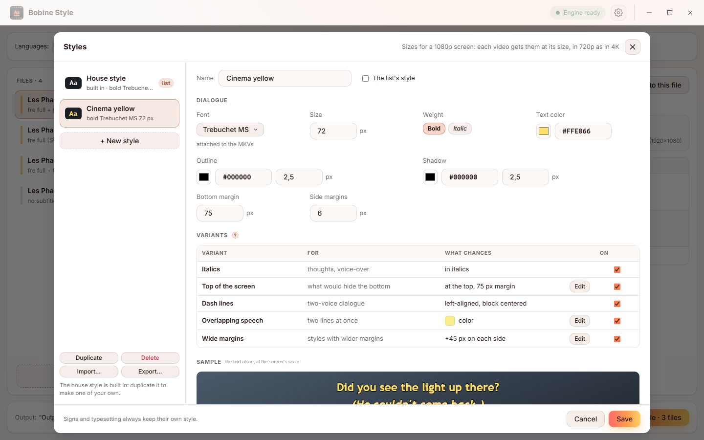

English | <a href="guide.fr.md">Français</a>

# User guide

This guide explains how to use Bobine Style and exactly what it does to a file. For installing it, see the [README](../README.md#install). The interface is in French or English (⚙ *Settings*, *Language*); its labels are quoted below in English.

## Contents

1. [Words to know](#words-to-know)
2. [Processing files](#processing-files)
3. [Languages and the default track](#languages-and-the-default-track)
4. [Reading a file's details](#reading-a-files-details)
5. [Styles](#styles)
6. [The right size on every video](#the-right-size-on-every-video)
7. [How roles are found](#how-roles-are-found)
8. [Track names](#track-names)
9. [Fonts](#fonts)
10. [Settings](#settings)
11. [FAQ](#faq)

## Words to know

- **Full track**: subtitles for the whole film, every line.
- **Forced track**: only what the audio doesn't say in that language: signs, foreign-language passages. Players show it on their own when the audio is in that language.
- **Style**: in an ASS subtitle file, a named set of font, size, colours, position. Each line uses one.
- **Role**: what a style is for: dialogue, italics (thoughts, voice-overs), top of the screen, dash lines (two speakers in one subtitle), overlapping speech, or typesetting (signs, titles, karaoke).
- **House style**: the style Bobine Style comes with, described [below](#the-house-style). You can make your own from it.

## Processing files

1. **Add MKV files**: on the empty window, click the drop zone to pick files, or *Add a folder…*; once the list has files, *+ Add MKVs* under it. Or drop files or folders anywhere on the window. A folder brings its MKVs and, with *Include subfolders (seasons)* ticked, those of its seasons. `Output` folders and unfinished files are never picked up.
2. **Choose the languages** at the top: *Languages* (the subtitles to restyle and rename), *Default subtitles* and *Style* (see [below](#languages-and-the-default-track)). Every file is read again when they change.
3. **Check** what will be done: click a file to see its [details](#reading-a-files-details) on the right.
4. **Apply** (*Apply the style*, bottom right, with the number of files to process): two files at a time, each with its progress. *Cancel export* stops: the file being written is deleted, the originals are untouched either way. *Apply to this file*, in a file's details, processes it on its own.

**Where the results go** (*Output*, bottom left, *Change…*):

- *Next to them*: an `Output` folder next to each file, under the same name;
- *Other folder*: one folder for everything; two episodes with the same name from different seasons go into their season's subfolder.

*Redo files already processed* processes again files whose result already exists; otherwise they're marked *Already processed* and skipped, so an interrupted series can simply be started again.

Each file of the list shows what will be done to it (*fre full + forced · 8 fonts*…) and its state: *Reading…*, *Ready*, *Already processed*, *Nothing to do* (no subtitles in the chosen languages), *Unreadable*, *Waiting*, *Done*, *Failed* (with the reason in its details), *Cancelled*. With the pointer on it, ↑ ↓ move it in the list and ✕ takes it off (*Remove all* empties the list). « folds the list to give the details more room. The ↑ and ↓ keys go from one file to the next.

## Languages and the default track

**Languages**: the subtitle languages to process, one or several (French by default). Once files are read, the list offers the languages found in them. A track of a chosen language is restyled and renamed; tracks in other languages are copied untouched. A track with no language tag is taken by its title (*VOSTFR*, *English*…), or, when a file has none in the default language, as being in it.

**Default subtitles**: the language whose track becomes the default one, following the default audio (the audio track flagged default, or the first one):

| Default audio | Default subtitles |
|---|---|
| In that language | its forced track (none if it has no forced track) |
| Another language, unknown, or none | its full track (the forced one if it has no full track) |

A subtitle track of another language that was default isn't any more, so that players pick this one.

Within a language, the track with the most dialogue is the **full** one. A track is **forced** when it's flagged so, when its title says so (*forc…*, *Signs*, *Panneaux*), or when it has less than half the full track's dialogue.

## Reading a file's details

Click a file to see, on the right:

- its size and its subtitle tracks, then **the default audio** and the subtitle track that follows from it;
- **the style applied** (*Style applied*): the list's, or another one for this file only, picked there; with its size, colours and margins, and the video's size it's fitted to;
- **each subtitle track**: what it is now (language, format, title), what it becomes (*Becomes*), its flags (*Flags*: *default*, *forced*) and its processing (*Processing*):
  - *Style “…”*: an ASS track restyled, with its number of lines;
  - *SRT converted to ASS*: an SRT track converted, then styled;
  - *Copied as is*: copied untouched (a language not chosen, image subtitles).

  Under a restyled track, each of its styles' role (*Default: dialogue*, *Thoughts: italic*…) and anything worth knowing;
- **the fonts** to attach (*Fonts attached*) and those already in the file (*Already in the MKV*);
- **the output path** (*Output*), then, once written, *Open the folder*.

## Styles

*Style* at the top picks the list's style; a file can take another one in its details. *Edit styles…* opens the styles:

<picture>
  <source media="(prefers-color-scheme: dark)" srcset="screenshots/styles-en-dark.png">
  
</picture>

- **The house style** is built in and can't be changed: *Duplicate* it, or *+ New style*, to make one of your own.
- **A style's dialogue**: *Font* (any font of your computer: it's attached to the MKVs), *Size*, *Bold*, *Italic*, *Text color*, *Outline* and *Shadow* (colour and width), *Bottom margin*, *Side margins*. The sample shows the text at the screen's scale.
- **Its variants**: a file's dialogue styles each take one by their use (see [How roles are found](#how-roles-are-found)). Each can be turned off: the styles it would have got then take the dialogue's look. *Edit* changes what a variant changes (the top margin, the overlap colour, the extra margins).
- *The list's style* makes it the one at the top.
- *Import…* and *Export…* read and write a `styles.json` file, to keep your styles or take them to another computer. Imported styles are added to yours (renamed if a name is taken).

Your styles are kept in `styles.json` in the app's data folder. Signs and typesetting always keep their own style.

### The house style

On a 1080p 16:9 screen:

| | |
|---|---|
| Font | Trebuchet MS bold, 66 px |
| Colour | white, black outline 2.5 px, black shadow 2.5 px |
| Position | centred, 75 px from the bottom of the picture |

Its variants keep all of that and change one thing:

- **Italics**: the same in italics (upright when the dialogue itself is in italics).
- **Top of the screen**: at the top, 75 px from it (lines that would cover something at the bottom).
- **Dash lines**: left-aligned so the dashes line up, the block centred under the picture. Its margin is computed from the text's real width in the style's font.
- **Overlapping speech**: in light yellow.
- **Wide margins**: 45 px more on each side.

## The right size on every video

A style's sizes are on-screen sizes, for a 1080p screen. A 720p video gets them two thirds as big, a 4K one twice as big, so they look the same on the TV. A scope film (1920×800) or a 4:3 one (1440×1080) keeps exactly the 16:9 size, as it's shown with black bars on a 16:9 screen. An anamorphic DVD is measured at its displayed size.

**Signs never move.** In an ASS file, positions and sizes written in the lines (`\pos`, `\fs`…) are in the script's own grid (its *PlayRes*). When lines carry them, that grid is kept and the style is converted into it; otherwise the grid takes the video's size. Either way, borders are scaled with the picture (`ScaledBorderAndShadow: yes`).

## How roles are found

From how styles are used, never from their names (except to recognise typesetting: *Sign*, *Title*, *OP*, *Karaoke*…).

- A line is **dialogue** unless its tags place it (`\pos`, `\move`), draw, do karaoke or change its font.
- A style is a **dialogue style** when most of its lines are dialogue, or when it carries a real part of the file's dialogue. That second rule matters for streaming subtitles that typeset signs with the dialogue style: an opening full of signs doesn't make it a sign style.
- The main dialogue style is the upright one with the most lines. The others get their role from their look: italic → italics, aligned at the top → top of the screen, mostly dash lines → dash lines, lines running over the main style's → overlapping speech, wider side margins → wide margins.
- Anything else is **typesetting** and left exactly as it was.

SRT files have no styles: their italics (`<i>`), top lines (`{\an8}`) and dash lines take the matching variants.

The CLI's `bobinestyle inspect file.mkv` shows this analysis for each track.

## Track names

Tracks are named in their own language, so that they read the same whatever the player's language:

- full: **Français**, **English**, **Deutsch**, **Español**, **Italiano**, **Português**, **Nederlands**, **Polski**, **日本語**;
- forced: **Français (forcé)**, **English (forced)**, **Deutsch (erzwungen)**… and flagged forced.

A language not in this list keeps its code (`swe`, `swe (forced)`). Two tracks of the same kind keep their old title after the name to stay apart.

## Fonts

Bobine Style ships no subtitle font: Trebuchet MS (a Microsoft font) can't be redistributed. Fonts are taken from your computer and attached to your files, which is what makes the subtitles look the same everywhere:

- the style's font, in its four faces (regular, bold, italic, bold italic);
- every font the restyled subtitles use: their styles' and those named in the lines (`\fn`), for signs.

A font already in the MKV isn't attached twice. A font missing from your computer is listed in the file's details; the subtitles then show with a substitute font on players that don't have it either.

## Settings

⚙ at the top right:

- *Theme*: *System*, *Light* or *Dark*;
- *Language*: *System*, *Français* or *English* (*System* is French if your system is in French, English otherwise);
- *Interface size*: makes the whole interface bigger or smaller;
- *Updates*: *Check at startup* asks GitHub whether a new version exists; nothing is installed without your consent.

## FAQ

**Plex still shows plain white subtitles.** That client converts ASS to plain text (some TV apps do). Try Plex on a computer, or set the client's subtitles to "burn" so the server draws them into the picture with the style.

**A file says *Nothing to do*.** It has no subtitle track in the chosen languages (or only image ones: PGS, VobSub, which can't be restyled).

**Why is my "Signs" track not restyled?** It's only typesetting: restyling it would undo its design. It's still named and flagged forced.

**The subtitles of a scope film sit on the picture, not in the black bars.** Players draw subtitles inside the video. When the bars are part of the video itself (a 1920×1080 file with black bars), 75 px from the bottom usually falls in the bar; with cropped files (1920×800), it can't.

**Is the original changed?** Never. Outputs are written under a temporary name, checked (same streams, same codecs, same duration, Dolby Vision kept) and only then renamed.
